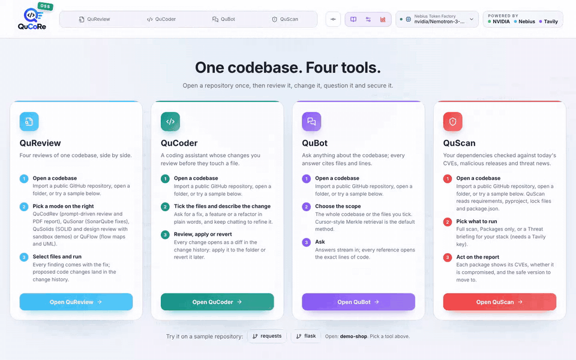
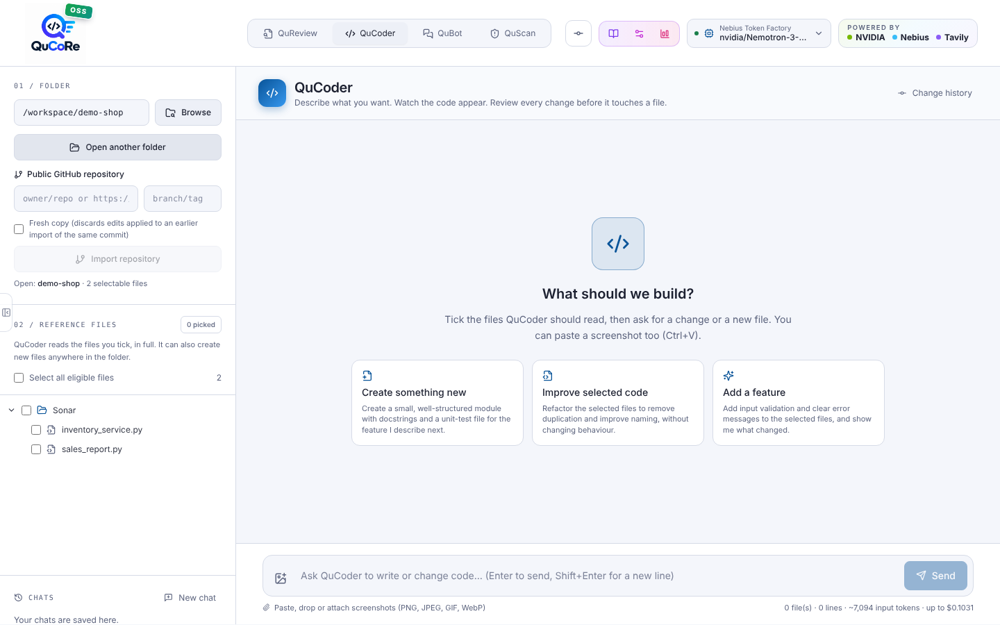
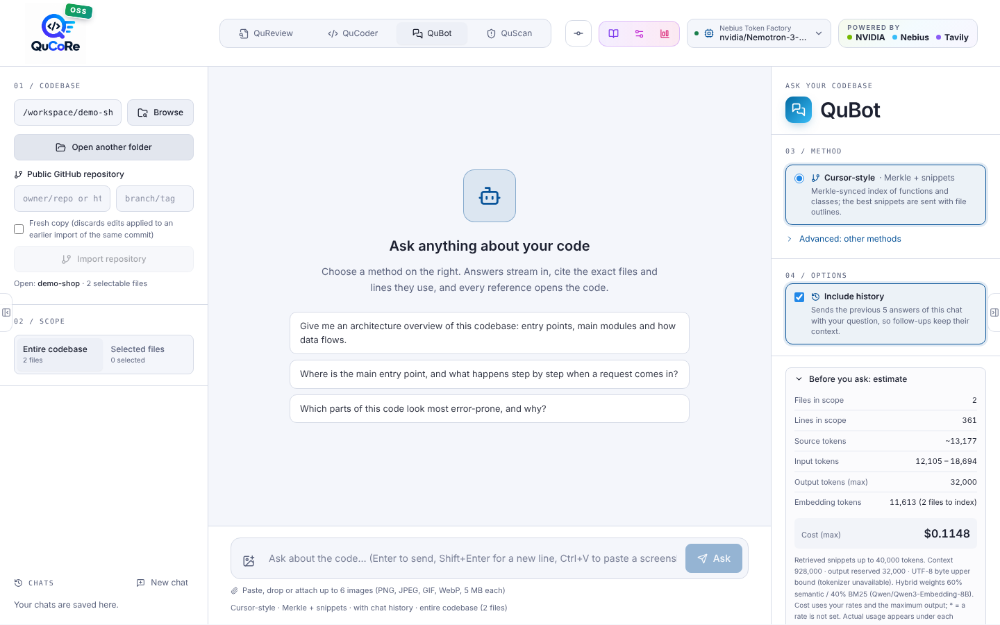
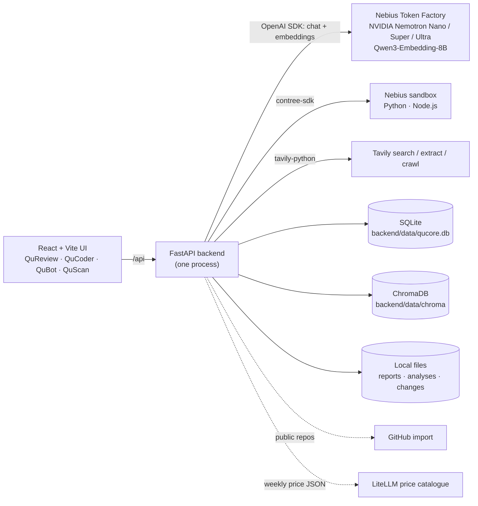

<div align="center">


# QuCoRe · Quick Code Review

### A suite of code review and development tools, powered by Nebius.
**QuCoRe uses Nebius models (NVIDIA Nemotron on Token Factory), the Nebius sandbox and Tavily to review, design, fix
and secure your code — and to help you create production-grade code files.**

[](LICENSE)


[**Live demo**](#hosted-demo) · [**Install locally**](#quick-start-local) · [**Run in Docker**](#quick-start-docker) · [**Hosted vs open source**](#hosted-edition-vs-this-open-source-edition) ·
[**Try it in 5 minutes**](#try-it-in-5-minutes) · [**Nemotron & Nebius**](#how-nvidia-nemotron-is-used) · [**Roadmap**](#roadmap)

**🌐 Live demo:** `https://<your-demo-url>` &nbsp;·&nbsp; **🎬 Demo video:** `https://<your-video-url>`

Built by **ThatAICompany** under the leadership of **Akshay M** for the **Nebius × NVIDIA Global AI Hackathon**.
Powered by **Nebius**, **NVIDIA** and **Tavily**.


</div>

---

## What is QuCoRe?

> **QuCoRe (Quick Code Review) is a suite of code review and development tools that uses Nebius models, the Nebius
> sandbox and Tavily to assist developers and create production-grade code files** — following good software
> engineering (SOLID, clean design, a passing quality gate, safe dependencies) and getting newcomers productive on day one.
>
> - **Nebius models** — NVIDIA Nemotron (Nano / Super / Ultra / Nano Omni) and Qwen3 embeddings on **Nebius Token Factory**
>   write every review, fix, diagram, answer and threat analysis.
> - **Nebius sandbox** — model-written code runs remotely in the Nebius sandbox (`contree-sdk`), never on your computer.
> - **Tavily** — live web search for CVEs, advisories and supply-chain news on your dependencies.

AI coding assistants are built to **write** code. Nobody gave teams an AI built to keep code **good**: reviewed against
the team's own standards, checked against SOLID and object-oriented design, documented as high- and low-level design,
SonarQube quality gate fixed, dependencies free of known CVEs, and explained to the next developer who joins.

QuCoRe is that tool — one open-source app, on open NVIDIA Nemotron models, where **you bring your own Nebius key**:
no seats, no credit packs, you pay Nebius Token Factory prices directly and see every cent in the dashboard.

| You want to… | QuCoRe tool |
|---|---|
| Review code against **your own** checklist and get a PDF report | **QuCodRev** — custom-prompt review |
| Check **SOLID, OOP, design patterns, HLD and LLD**, with scores and the fixed design | **QuSolids** — engineering-principles review, demos run in the Nebius sandbox |
| Get **flow diagrams, HLD and UML** of an unfamiliar codebase | **QuFlow** — flow maps and UML (Mermaid or React Flow) |
| **Pass the SonarQube quality gate** without hand-fixing hundreds of issues | **QuSonar** — upload the export, get every issue explained and fixed |
| **Ask questions** about the codebase and get answers with file + line citations | **QuBot** — code Q&A, hybrid RAG and Merkle-synced retrieval |
| **Write the change** you asked for, as a reviewable diff | **QuCoder** — chat coder: diff, apply, revert |
| Know which **dependencies have CVEs** or were compromised, and the safe version | **QuScan** — dependency threat intelligence with Tavily |

Every code change goes to a **change history** where you review the diff and apply or revert it. Every run is priced
in the **cost & token dashboard**.

---

## Contents

- [Why QuCoRe](#why-qucore) · [Screenshots](#screenshots) · [Hosted demo](#hosted-demo) · [Hosted vs open source](#hosted-edition-vs-this-open-source-edition) · [Guided tours](#guided-tours)
- [Hackathon track](#hackathon-track) · [How NVIDIA Nemotron is used](#how-nvidia-nemotron-is-used) ·
  [Where Nebius Token Factory accelerated the workflow](#where-nebius-token-factory-accelerated-the-workflow) ·
  [The Nebius sandbox](#the-nebius-sandbox-how-qusolids-runs-code) · [Tavily](#how-tavily-is-used)
- [How it was built](#how-it-was-built) · [Architecture](#architecture)
- [Quick start (local)](#quick-start-local) · [Create and fill backend/.env](#create-and-fill-backendenv) · [Quick start (Docker)](#quick-start-docker) ·
  [Self-host on a server](#self-host-on-a-server)
- [Try it in 5 minutes](#try-it-in-5-minutes) · [Configuration](#configuration) · [Credentials](#credentials-screen) ·
  [Data, privacy and automatic deletion](#data-privacy-and-automatic-deletion)
- [Project structure](#project-structure) · [Troubleshooting](#troubleshooting) · [Roadmap](#roadmap) ·
  [Contributing](#contributing) · [License](#license)

---

## Why QuCoRe

**1. Built for code quality, not just code generation.** General AI coding assistants (GitHub Copilot, Cursor,
Claude Code) are excellent at writing code in an editor. QuCoRe covers what happens around it: engineering-principle
reviews, design documentation, quality-gate remediation, onboarding Q&A and dependency security — as dedicated tools
with structured, validated output (scores, PDFs, diagrams, diffs), not a chat transcript.

**2. Onboarding in an afternoon, not a month.** A newcomer opens the repository, gets the flow map and UML (QuFlow),
asks "where does a request get authenticated?" and lands on the exact lines (QuBot), and reads the design review
(QuSolids) to learn the codebase's strengths and debts. Built-in [guided tours](#guided-tours) walk through every tool.

**3. Bring your own key, pay per token.** QuCoRe calls Nebius Token Factory with **your own Nebius key** (and your own
Tavily key for QuScan). There are no seats or bundled credits to buy; pick Nemotron Nano for quick questions and Ultra
for deep reviews, and the dashboard prices every run.

**4. Open source and private by default.** Apache-2.0, runs on your machine or your server, stores everything
locally (SQLite, ChromaDB, files), and can delete its local files automatically after N days.

**5. Trustworthy output.** Arithmetic is done by code, not by the model: QuSolids scores, QuScan version-range checks,
token budgets and costs. Findings are validated against the real files; CVE ids not present in the evidence are
dropped; diagram syntax is generated deterministically from validated JSON.

| | General AI coding assistants | Static analysers | AI pull-request reviewers | **QuCoRe** |
|---|---|---|---|---|
| Main job | Write code in the editor | Detect rule violations | Comment on pull requests | **Review, design, fix and secure the whole codebase** |
| SOLID / OOP / HLD / LLD review with scores | — | — | partial | **Yes (QuSolids)** |
| Explain *and fix* SonarQube issues from an export | — | detects them | — | **Yes (QuSonar)** |
| Flow maps and UML from code | — | — | — | **Yes (QuFlow)** |
| Code Q&A with file + line citations | chat | — | — | **Yes (QuBot)** |
| Dependency CVE + threat news with safe versions | — | some | — | **Yes (QuScan)** |
| Open source, self-hosted, bring your own key | varies | varies | varies | **Yes (Apache-2.0, Nebius + Tavily keys)** |

*Categories, not specific products; capabilities of individual products vary and change. QuCoRe is complementary to
your editor assistant — use both.*

---

## Screenshots

| QuSonar — SonarQube export matched to the code | QuCodRev — token and cost plan before any call |
|---|---|
|  |  |
| **QuSolids — SOLID / OOP / HLD / LLD focus areas** | **QuCoder — describe a change, review the diff** |
|  |  |
| **QuBot — ask the codebase** | **Credentials — bring your own Nebius and Tavily keys** |
|  |  |

<sub>Recorded from the real UI. Model output is shown in the demo video: `https://<your-video-url>`.</sub>

---

## Hosted demo

**Demo URL: `https://<your-demo-url>`** <!-- replace with the public hosted URL -->

The public demo runs the **hosted edition** of QuCoRe, built on this open-source core. Every tool, model call and
sandbox run is the same; what changes is sign-in and where data is stored.

### Hosted edition vs this open-source edition

| | **Open-source edition (this repository)** | **Hosted edition (live demo)** |
|---|---|---|
| **Who uses it** | One person, on their own computer or server | Many people on one public website |
| **Login** | **None** — download, run, and the app opens straight to the home page | **Sign in with Google or GitHub**, or **Use as Guest** for a quick look; every person's data is private to them |
| **API keys** | Your own Nebius / Tavily keys in `backend/.env` (or the Credentials screen) | Shared demo keys with **daily run limits**, or **bring your own key** per person (stored encrypted) |
| **Database** | **SQLite** file — `backend/data/qucore.db` | **Cloud PostgreSQL** (Supabase) |
| **Reports, analyses, change history** | **Local files** in `backend/data/` | **Cloud object storage** (Supabase Storage, private bucket) |
| **QuBot vector index** | **ChromaDB**, local folder `backend/data/chroma` | **Qdrant Cloud** |
| **Opening code** | Type a folder path or press **Browse**, or import a public GitHub repo | Upload a folder from your browser, or import a public GitHub repo |
| **Data deletion** | Optional: `QUCORE_AUTO_DELETE` after N days | Automatic after a set number of hours; guest data when the guest leaves |
| **Internet needed for** | Nebius Token Factory, Nebius sandbox, Tavily (and GitHub imports) | The same, plus the cloud database, storage and vector services |

Nothing in this edition needs a cloud database or an account: your code, reports and index stay on your machine and
only go to Nebius (and Tavily for package names) when you run a tool.

---

## Guided tours

QuCoRe ships with interactive **guided tours** (driver.js, navy QuCoRe theme). The first time you open the app a short
**overview** walks through the header, workspace, model switch, change history and tabs; the first time you open each
tool its own chapter starts (QuCodRev, QuSonar, QuSolids, QuFlow, QuCoder, QuBot, QuScan). Press **?** in the header any
time to replay the full tour or one tool's chapter, or to download the **sample review PDF**. Tours remember what you
have seen in the browser only (no account, nothing sent to a server).

---

## Hackathon track

**Coding and Agentic Engineering Track — developer tools.** QuCoRe is a developer tool that writes, runs and tests code
with models served by Nebius Token Factory: QuCoder and QuSonar write fixes as reviewable diffs, and QuSolids runs its
proposed designs in the Nebius sandbox.

---

## How NVIDIA Nemotron is used

Every review, fix, diagram, answer and threat analysis is generated by **NVIDIA Nemotron** open models through
Nebius Token Factory (`backend/app/llm.py`, `backend/app/qa_llm.py`).

| Where | Nemotron model (default) | Why |
|---|---|---|
| All tools by default: QuCodRev, QuSonar, QuSolids, QuFlow, QuBot, QuCoder, QuScan | `nvidia/Nemotron-3-Ultra-550b-a55b` (`NEBIUS_MODEL`) | Serious reasoning over whole files and long contexts. |
| Everyday reviews, QuCoder changes | Nemotron 3 **Super** (header switch) | Strong code generation at a lower price per token. |
| Quick QuBot questions | Nemotron 3 **Nano** (header switch) | Fast, cheap everyday calls keep the app responsive and credits stretching further. |
| QuBot with screenshots | `nvidia/Nemotron-3-Nano-Omni` (header switch) | Vision: images attached to a question. |

- **Pick the model per task** from the header switch: Nano for quick questions, Super for everyday reviews and changes,
  Ultra for design reviews and large codebases. Any model ID your endpoint serves can be typed in (Credentials).
- The dashboard records which model every run used and what it cost, so you can see the price of each choice.
- Inline reasoning that some Nemotron models write (`<think>…</think>`) is removed from answers, also while streaming.

## Where Nebius Token Factory accelerated the workflow

- **One OpenAI-compatible endpoint for everything:** chat, streaming and embeddings through the standard OpenAI SDK with
  `base_url = NEBIUS_BASE_URL` — one client, one key, one error path. Moving between Nano, Super and Ultra is a model-ID
  change, not a new integration.
- **Embeddings on the same key:** `Qwen/Qwen3-Embedding-8B` (default; any Token Factory embedding model works) powers
  QuBot retrieval over a local ChromaDB index and QuCodRev's semantic file ordering.
- **Live model catalogue:** the backend reads `GET /v1/models` and fills the dropdowns with the exact IDs your endpoint
  serves, correcting letter case before each call.
- **Long context windows:** QuCodRev and QuSonar send whole files instead of fragments; every request is checked against
  `NEBIUS_CONTEXT_WINDOW` before it is sent.
- **Transparent cost:** Nebius prices (`nebius/<model>`) from the LiteLLM public price catalogue (JSON only, no package)
  price every run in the dashboard.

## The Nebius sandbox: how QuSolids runs code

QuCoRe never runs model-written code on your computer. It runs it in the **Nebius sandbox** with `contree-sdk`
(`backend/app/sandbox.py`), using `NEBIUS_API_KEY` and `NEBIUS_PROJECT_ID`:

```python
image = ContreeSync().images.oci("python:3.12")       # imported into your Nebius project on first use
image.run("python", args=["-c", code]).wait()          # Python demos
ContreeSync().images.oci("node:22-slim").run("node", args=["-e", code]).wait()   # Node.js demos
```

**QuSolids (Python and JavaScript / TypeScript file testing):**

1. Tick **Run proposed code in the sandbox** before a QuSolids review. For findings in **Python** files Nemotron returns
   a complete, standard-library **Python demonstration** with dummy data that builds the *old* and the *new* design
   side by side and prints why the new one is better. The backend checks that it compiles before showing it.
2. Findings in **JavaScript / TypeScript** files (`.js .jsx .ts .tsx`, React components and hooks included) get a
   **Node.js demonstration** on request (**Write a demo**): plain JavaScript that models the components and hooks as
   functions with dummy data, syntax-checked before it is shown, run with `node -e`. Findings in other languages have
   no sandbox demo.
3. Each finding shows an editor and console (**Try the proposed design in the sandbox**, labelled Python or Node.js)
   with four actions: **Run**; **Edit** (change the program by hand, **Undo edits** to go back); **Reset** (Nemotron
   writes a new program for the finding); and **Fix with AI** after a failed run (the program, its output and the
   error go back to Nemotron, which returns a corrected program to run again).
4. A short-lived worker process sends the program to the Nebius sandbox and streams the stage, `stdout`, `stderr` and
   exit code back. Keys are masked in all output, there is a hard deadline, **Stop** ends the run at once, and runs are
   kept in memory only. Images: `QUCORE_SANDBOX_IMAGE` (default `python:3.12`) and `QUCORE_SANDBOX_NODE_IMAGE`
   (default `node:22-slim`); the first run of each imports it into your Nebius project and takes longer.

## How Tavily is used

**QuScan** (`backend/app/quscan*.py`) uses your Tavily key (`TAVILY_API_KEY`, bring your own):

- **search** for advisories and CVEs per package, plus an optional supply-chain / malware search,
- **extract** of OpenCVE result pages into structured CVE rows (optional **crawl** of the CVE pages),
- **news search** over the last day / week / month for your ecosystems, summarised into a threat briefing.

Nemotron reads the evidence and returns CVEs, affected ranges, fixed versions and citations; the backend checks your
installed / locked / pinned version against those ranges arithmetically and prints upgrade commands for your package
manager.

---

## How it was built

Every tool follows the same pattern: **read the code exactly → plan the tokens → call Nemotron → validate the answer
in code → save a report or a reviewable change.**

| Tool | How it works | Main files |
|---|---|---|
| Workspace | Opens a local folder or a public GitHub commit; skips dependencies, binaries and secret files (`.env`, keys are never sent to a model). | `workspace.py`, `github_import.py` |
| QuCodRev | Counts tokens locally, packs whole files into batches that fit the context window, optionally orders them with Nebius embeddings, sends each batch to Nemotron, normalises the Markdown and renders a PDF (ReportLab). | `review_pipeline.py`, `llm.py`, `pdf_report.py` |
| QuSonar | Parses the SonarQube export (xlsx / csv / json), matches report paths to files by longest path suffix, sends each file with all its issues, returns explanations and fixed code; fixes go to the change history. | `sonar.py`, `analysis_api.py` |
| QuSolids | Computes structure metrics, the import graph and circular dependencies in code; Nemotron returns JSON findings (principle, location, before/after code, optional demo), validated against the files and scored by the backend; demos run in the Nebius sandbox. | `solidify.py`, `solid_metrics.py`, `sandbox.py` |
| QuFlow / UML | Nemotron returns a small JSON graph; the backend validates it and the browser renders Mermaid or React Flow. | `flowmap.py`, `uml.py` |
| QuCoder | Streams an answer with SEARCH / REPLACE edit blocks, applies them in memory, shows a Monaco diff; you apply or revert. | `qucoder.py`, `changes.py` |
| QuBot | Syntax-aware chunks, Nebius embeddings in local ChromaDB synced with a Merkle tree, BM25 keyword search, 60/40 hybrid fusion, streamed answers with citations. | `qa_chunker.py`, `qa_index.py`, `qa_pipeline.py` |
| QuScan | Finds every dependency, gathers evidence with Tavily, Nemotron extracts fixed versions with citations, the backend checks version ranges. | `quscan*.py` |
| Dashboard | Every run's tokens × live Nebius prices, stored in SQLite. | `dashboard.py`, `pricing.py` |

## Architecture



**Backend:** Python 3.11+, FastAPI, OpenAI SDK, ChromaDB, SQLite, ReportLab, openpyxl.
**Frontend:** React 18, Vite 6, Tailwind 4, Monaco, Mermaid, React Flow.
**No sign-in** in this edition: it opens straight to the home page.

---

## Quick start (local)

### What you need

| | Version | Check |
|---|---|---|
| **Python** | 3.11 or newer | `python --version` (Windows) / `python3 --version` (macOS, Linux) |
| **Node.js** | 20.19 or newer (includes npm) | `node --version` |
| **Git** | any | `git --version` |
| **Nebius Token Factory API key** | — | <https://tokenfactory.nebius.com> |
| Nebius project ID *(optional, sandbox)* · Tavily key *(optional, QuScan)* | — | Nebius console · <https://tavily.com> |

### Step by step

**Step 1 — Download the code**

```bash
git clone https://github.com/<your-org>/qucore-nebius-oss.git
cd qucore-nebius-oss
```

**Step 2 — Create a Python virtual environment and install the backend**

```bash
cd backend
python -m venv .venv
# macOS / Linux:
source .venv/bin/activate
# Windows (PowerShell):
.venv\Scripts\Activate.ps1
# Windows (cmd):
.venv\Scripts\activate.bat

pip install -r requirements.txt
```

**Step 3 — Create your settings file**

```bash
# still in backend/
cp .env.example .env          # Windows: copy .env.example .env
```

Open `backend/.env` and paste your Nebius key into `NEBIUS_API_KEY='…'` (see
[Create and fill backend/.env](#create-and-fill-backendenv) for every key). You can also leave it empty now and fill
it in later from **Credentials** inside the app.

**Step 4 — Build the web interface**

```bash
cd ../frontend
npm ci                        # installs exactly the versions in package-lock.json
npm run build                 # creates frontend/dist
```

Out of memory? `NODE_OPTIONS=--max-old-space-size=6144 npm run build`
(PowerShell: `$env:NODE_OPTIONS="--max-old-space-size=6144"; npm run build`).

**Step 5 — Start QuCoRe**

```bash
cd ../backend                 # with the virtual environment still active
uvicorn app.main:app --host 127.0.0.1 --port 8000
```

**Step 6 — Open the app** at **<http://localhost:8000>**. There is no login: the home page opens, a short guided tour
starts, and you can open a folder or a sample GitHub repository. Stop the server with `Ctrl+C`.

**Next time** you only need: `cd backend`, activate the virtual environment, run the `uvicorn` command (step 5).
After pulling new code, repeat steps 2 and 4.

### Development mode (hot reload, optional)

```bash
# terminal 1 — backend (reloads on code changes)
cd backend && source .venv/bin/activate
uvicorn app.main:app --reload --reload-dir app --host 127.0.0.1 --port 9002

# terminal 2 — frontend (Vite dev server, forwards /api to port 9002)
cd frontend && npm run dev
```

Open <http://127.0.0.1:5183>. Add `http://127.0.0.1:5183,http://localhost:5183` to `QUCORE_ALLOWED_ORIGINS` in
`backend/.env`. Always run uvicorn with **one worker** (the default): open workspaces, jobs and streams live in that
process.

## Create and fill backend/.env

All configuration is one file, `backend/.env`. It is **git-ignored** — never commit it.

```bash
cp backend/.env.example backend/.env       # Windows: copy backend\.env.example backend\.env
```

Open `backend/.env` in any editor and fill in the values (keep the single quotes). Only the first one is required:

| Key | Required? | Where to get it |
|---|---|---|
| `NEBIUS_API_KEY` | **Yes** | <https://tokenfactory.nebius.com> → API keys → create key |
| `NEBIUS_BASE_URL` | pre-filled | Keep the default unless your Token Factory endpoint differs (must end in `/v1`). |
| `NEBIUS_MODEL` | pre-filled | Default `nvidia/Nemotron-3-Ultra-550b-a55b`; the header switch changes it per run. |
| `NEBIUS_PROJECT_ID` | For sandbox demos | Nebius console → your project → project ID (`project-…`). Needed for QuSolids **Run in sandbox**. |
| `QUCORE_SANDBOX_IMAGE`, `QUCORE_SANDBOX_NODE_IMAGE` | Optional | Defaults `python:3.12`, `node:22-slim`; put your own image name to add packages. |
| `TAVILY_API_KEY` | For QuScan | <https://tavily.com> → dashboard → API key. |
| `QUCORE_GITHUB_TOKEN` | Optional | A GitHub token raises the rate limit for public-repo imports. |

Minimal example:

```env
NEBIUS_API_KEY='your-token-factory-key'
NEBIUS_PROJECT_ID='project-xxxxxxxx'
QUCORE_SANDBOX_IMAGE='python:3.12'
QUCORE_SANDBOX_NODE_IMAGE='node:22-slim'
TAVILY_API_KEY='tvly-xxxxxxxx'
```

Everything else has working defaults and is documented line by line in `backend/.env.example`. You can also skip
editing the file: start the app and fill in **Credentials** (header) — it writes `backend/.env` for you.

## Quick start (Docker)

No Python or Node.js needed — only **Docker** (Docker Desktop on Windows / macOS, Docker Engine + Compose on Linux).

**Step 1 — Download the code**

```bash
git clone https://github.com/<your-org>/qucore-nebius-oss.git
cd qucore-nebius-oss
```

**Step 2 — Create your settings file** (Docker mounts it into the container)

```bash
cp backend/.env.example backend/.env       # Windows: copy backend\.env.example backend\.env
```

Put your `NEBIUS_API_KEY` (and optionally `NEBIUS_PROJECT_ID`, `TAVILY_API_KEY`) in `backend/.env`.

**Step 3 — Build and start**

```bash
docker compose up --build                  # first build takes a few minutes
```

**Step 4 — Open <http://localhost:8000>.** The `Sonar/` demo folder is mounted at **`/workspace`**: type `/workspace`
in the workspace box and press Open.

**Review your own project:** point `CODE_DIR` at it when starting:

```bash
CODE_DIR=/path/to/your/project docker compose up            # macOS / Linux
$env:CODE_DIR="C:\path\to\project"; docker compose up       # Windows PowerShell
```

then open `/workspace` in the app. (The native **Browse** dialog is not available inside a container; type the path.)

**Stop:** `Ctrl+C`, or `docker compose down`. `backend/.env` and `backend/data/` (database, index, reports) stay on your
machine between runs. After pulling new code, run `docker compose up --build` again.

## Self-host on a server

The same Docker image runs on any server or container platform (one container, 2 GB RAM recommended):

1. Build and run the image (`docker compose up --build`, or `docker build` + `docker run -p 8000:8000`).
2. Provide your `.env`: mount `backend/.env`, or a secret file at `/etc/secrets/.env` or `/run/secrets/qucore.env`
   (copied to `backend/.env` on every start). The container listens on `$PORT` if the host sets it, else 8000.
3. Set `QUCORE_ALLOWED_ORIGINS` (e.g. `https://qucore.yourdomain.com`) and `QUCORE_ALLOWED_HOSTS`
   (e.g. `qucore.yourdomain.com`) to your address.

> ⚠️ This edition has **no sign-in**. Anyone who can reach the URL uses your keys and can open Credentials. Keep it on
> a private network, or use the [hosted edition](#hosted-demo) for a public site.

---

## Try it in 5 minutes

**A. Pass a SonarQube quality gate (QuSonar).** The `Sonar/` folder has two small, generic Python programs and a
matching SonarQube export:

| File | What it is |
|---|---|
| `Sonar/inventory_service.py` | In-memory inventory service (products, stock movements, reorder list). `python Sonar/inventory_service.py` |
| `Sonar/sales_report.py` | CSV sales summariser (totals by region and month, best sellers). `python Sonar/sales_report.py` |
| `Sonar/sonarqube_simulated_issues.xlsx` | 20 simulated issues (10 per file: S107, S1172, S1481, S1854, S1871, S1192, S3776, S3984, S1764, S4143), paths written as `\Sonar\<file>`, exact line numbers. |

Open the `Sonar` folder (or the repository root) in **QuReview → QuSonar**, upload the `.xlsx` — paths are matched
automatically — and press **Fix 2 files · 20 issues**. Download the PDF; save fixes to the change history.

**B. Onboard onto a real project.** Click **requests** or **flask** on the home page (or open your own folder), then
go QuFlow (flow map + UML) → QuBot (ask questions, get file + line citations) → QuSolids (design review, sandbox
demos) → QuScan (dependency CVEs). Each tool's guided tour starts the first time you open it.

---

## Configuration

All settings live in **`backend/.env`** ([`backend/.env.example`](backend/.env.example) documents every key). The
**Credentials** screen edits the file **in place**: only changed values are rewritten; comments and order are kept.

| Key | Purpose |
|---|---|
| `NEBIUS_BASE_URL`, `NEBIUS_API_KEY` | **Bring your own Nebius key** — Token Factory endpoint and key. |
| `NEBIUS_MODEL` | Main model (default `nvidia/Nemotron-3-Ultra-550b-a55b`); any served model ID works. |
| `NEBIUS_EMBEDDING_MODEL` | Embeddings (default `Qwen/Qwen3-Embedding-8B`); empty = keyword search only. |
| `NEBIUS_CONTEXT_WINDOW`, `NEBIUS_MAX_OUTPUT_TOKENS` | Token limits of the chosen model. |
| `NEBIUS_PROJECT_ID` | Nebius project for the sandbox (QuSolids demos). |
| `QUCORE_SANDBOX_IMAGE`, `QUCORE_SANDBOX_NODE_IMAGE` | Sandbox images (default `python:3.12`, `node:22-slim`); any OCI image name, e.g. your own. |
| `TAVILY_API_KEY` | **Bring your own Tavily key** for QuScan (also in Credentials → Tavily web search). |
| `QUCORE_QA_HISTORY_TURNS` | Previous QuBot answers sent with "Include history" (default 5). |
| `QUCORE_AUTO_DELETE`, `QUCORE_AUTO_DELETE_DAYS` | Automatic deletion of local files. |
| `QUCORE_LIVE_PRICING`, `QUCORE_PRICING_REFRESH_HOURS` | Live Nebius prices from the LiteLLM catalogue. |
| `QUCORE_TABS`, `QUCORE_SAMPLE_REPOS` | Which of the 4 tabs to show; sample repositories on the home page. |

### Credentials screen

The main keys can be set in the app (**Credentials**, in the header) instead of editing the file: **Nebius Token
Factory** (base URL, API key, model, embedding model, token limits), **Code sandbox** (Nebius project ID) and **Tavily
web search**. Saving writes `backend/.env` in place; keys are shown masked and never sent back to the browser.
The sandbox images are set in `backend/.env` (use your own image if your demos need extra packages):

```env
NEBIUS_PROJECT_ID='your-nebius-project-id'
QUCORE_SANDBOX_IMAGE='python:3.12'
QUCORE_SANDBOX_NODE_IMAGE='node:22-slim'
```

## Data, privacy and automatic deletion

- **Local storage only:** `backend/data/qucore.db` (SQLite), `backend/data/chroma` (ChromaDB) and files in
  `backend/data/*` (PDF / JSON reports, analyses, change history, QuBot index state, GitHub downloads).
  `QUCORE_DATA_DIR` moves the folder.
- **Keys** stay in `backend/.env` and are never sent to the browser. Real `.env` files and private keys in your code are
  never sent to a model.
- **Where code goes:** only to Nebius Token Factory (and the Nebius sandbox for programs you run). QuScan sends
  package names to Tavily.
- **Automatic deletion:** `QUCORE_AUTO_DELETE='true'`, `QUCORE_AUTO_DELETE_DAYS='7'`. Counted from the first use
  (`backend/data/.first_use`); when the days have passed, everything inside the sub-folders of `backend/data` is
  deleted and the count restarts. Checked at start-up and hourly, never during a run. `qucore.db` and `.env` are kept.

---

## Project structure

```
qucore-oss/
├── README.md · LICENSE (Apache-2.0) · NOTICE
├── docs/assets/                screenshots and GIFs used in this README
├── Dockerfile · docker-compose.yml · docker-entrypoint.sh
├── Sonar/                      QuSonar demo: 2 Python programs + SonarQube export (.xlsx)
├── backend/
│   ├── .env.example            every setting, documented
│   ├── requirements.txt
│   └── app/                    main.py, config.py, env.py, llm.py, qa_llm.py, sandbox.py,
│                               sonar.py, solidify.py, flowmap.py, uml.py, qucoder.py, qa_*.py, quscan*.py,
│                               pricing.py, dashboard.py, cleanup.py, …
└── frontend/                   React + Vite (src/App.jsx, src/components/… incl. AppTour.jsx guided tours)
```

## Troubleshooting

| Problem | Fix |
|---|---|
| "Set the Nebius base URL and API key in Credentials." | Add `NEBIUS_API_KEY` in Credentials or `backend/.env`. |
| Sandbox: "Add the Nebius API key and Nebius project ID…" | Set `NEBIUS_PROJECT_ID` (Credentials → Code sandbox). |
| QuScan cannot search | Add your Tavily key (Credentials → Tavily web search). |
| `npm run build` runs out of memory | `NODE_OPTIONS=--max-old-space-size=6144 npm run build` (PowerShell: `$env:NODE_OPTIONS="--max-old-space-size=6144"`). |
| **Browse** says no desktop / no tkinter | Paste the absolute folder path instead. |
| "QuCoRe accepts requests from its local UI only." | Open the app at an origin listed in `QUCORE_ALLOWED_ORIGINS`. |
| Token counts say "UTF-8 byte upper bound" | `tiktoken` could not download its vocabulary (offline); estimates are conservative. |
| Model not found (404) | Pick a model your endpoint serves; the dropdown lists what `GET /v1/models` returns. |

## Roadmap

**Available now:** QuCodRev, QuSonar, QuSolids (with Nebius sandbox demos), QuFlow / UML, QuCoder, QuBot, QuScan,
change history, cost dashboard, Credentials, guided tours.

**Coming soon:**

- [ ] **QuTest** — Nemotron writes pytest suites for your Python files and runs them in the Nebius sandbox, with Fix with AI.
- [ ] **Pull-request integration** — review a GitHub / GitLab PR and post findings as review comments.
- [ ] **Quality-gate re-check** — re-run the SonarQube export after QuSonar fixes and show the gate status.
- [ ] **Team rules packs** — share QuCodRev prompts and QuSolids focus areas across a team.
- [ ] **More sandbox languages** — Java, Go and Rust demos in the Nebius sandbox.
- [ ] **IDE extensions** — VS Code and JetBrains panels on the same backend.
- [ ] **Enterprise edition** — SSO and bring-your-own-key for Azure / AWS / GCP model endpoints.

## Contributing

Issues and pull requests are welcome. Please keep secrets out of commits (`backend/.env` is git-ignored).

## License

**[Apache License 2.0](LICENSE)** — Copyright 2026 ThatAICompany. NVIDIA, Nemotron, Nebius, Tavily, SonarQube and
other names are trademarks of their respective owners, used only to describe what QuCoRe works with.

<div align="center">
<sub>Built by ThatAICompany under the leadership of Akshay M for the Nebius × NVIDIA Global AI Hackathon · Powered by Nebius, NVIDIA and Tavily.</sub>
</div>
